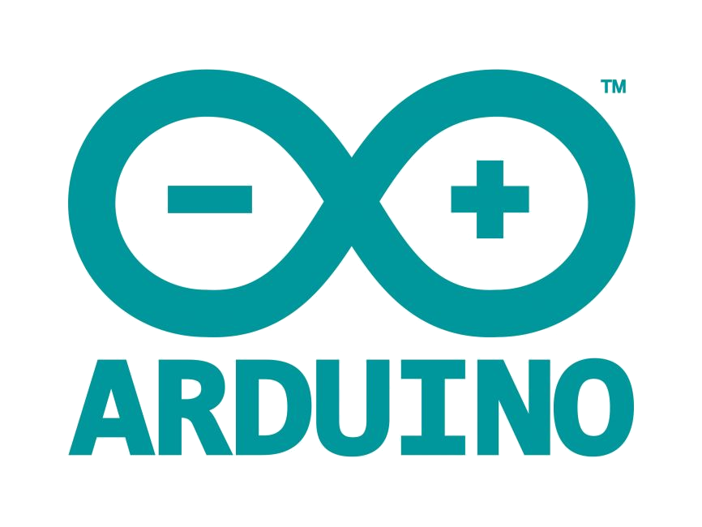
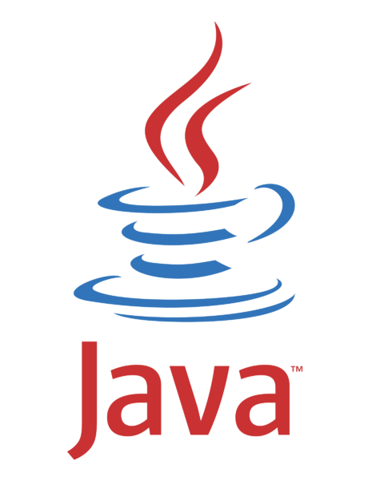
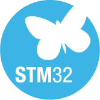

## Hello there, Dear Sir or Madam 

    This Github account belongs to the software engineer at Ocado Technology since 2022, considering himself a self-taught programmer, math and electronics geek since 2018 and an engineer in computer science at Wroclaw University of Science and Technology since 2024

### About me

22 yrs old man from Cuiavia and Wroclove

Fan of books, cycling, skating, exploring new places and learning new things

Started my adventure with Arduino and embedded, later with web development. At the moment - software engineer gaining experience

    
    
    
    
    
     

### "Talk is cheap, show me the code" ~~ Linus Torvalds

    
    

